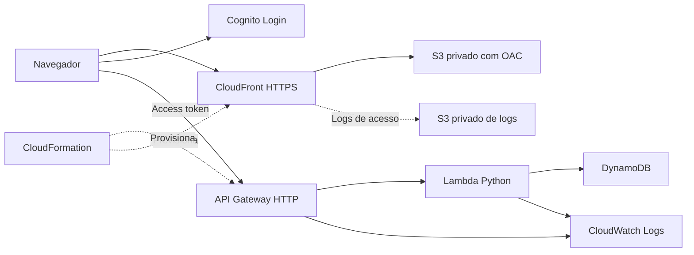

# Chácara Retirinho | Projeto Integrado

Sistema web para registrar entradas e saídas de batatas, consultar o estoque por qualidade, tamanho e embalagem e identificar o responsável por cada lançamento. Desenvolvido para a Chácara Retirinho, Grupo Canela, no Projeto Integrado de **Computação em Nuvem e Qualidade de Software** da UNIFEOB.

**Site:** https://d1rgdc3ev01d0e.cloudfront.net/

**Versão documentada:** `online-2-auditoria`, publicada em 08/11/2026. O site exige um acesso previamente convidado. A prévia local usa dados fictícios.

## Equipe e identificação acadêmica

| Integrante | RA |
|---|---|
| Gabriel Trinca de Marchi | 24002112 |
| Miguel Augusto de Faria Camilo | 24002076 |
| Thiago Perinoto Correa | 24002167 |
| Wagner da Silva Gomes Junior | 24002152 |

UNIFEOB - Escola de Negócios e Tecnologia EAD. Curso de Análise e Desenvolvimento de Sistemas, 4º trimestre letivo de 2026. Orientadora indicada no documento do módulo: **Prof.ª Mariangela Martimbianco Santos**. São João da Boa Vista, SP, novembro de 2026.

## Documentação

- [Guia AWS: primeira publicação, atualizações e operação](docs/GUIA_AWS.md).
- [Relatório geral do PI e análises das unidades de estudo](docs/RELATORIO_PI.md).
- [Guia AWS em PDF](docs/Guia-AWS-publicacao-e-atualizacoes.pdf) e [versão editável](docs/Guia-AWS-publicacao-e-atualizacoes.docx).
- [Relatório do PI em PDF](docs/Documentacao-Projeto-Integrado.pdf) e [versão editável](docs/Documentacao-Projeto-Integrado.docx).
- [Evidências e limites da validação](docs/VALIDACAO.md).

## Funcionalidades e acessos

| Recurso | Administrador | Operador | Visualizador |
|---|:---:|:---:|:---:|
| Consultar histórico, estoque e filtros | Sim | Sim | Sim |
| Registrar entradas e saídas | Sim | Sim | Não |
| Excluir logicamente lançamentos | Sim | Não | Não |
| Convidar, pausar e alterar acessos | Sim | Não | Não |
| Consultar Integrações e Auditoria | Sim | Não | Não |

Os históricos mostram o responsável pela entrada e pela saída. Há filtros de qualidade, tamanho, período e pesquisa; a câmara é um dado das entradas. O saldo atual considera todos os períodos para a qualidade e o tamanho selecionados. Caixotes, sacos, meiões e bags têm saldos independentes, sem conversão automática entre embalagens.

O peso líquido da entrada é calculado a partir do bruto e da tara. O peso de saída em kg é opcional. Registros sem peso tornam o saldo em kg **parcial**; o bloqueio transacional de saldo negativo é aplicado às quantidades de embalagens. O peso não substitui esse controle.

Auditoria e acessos ficam dentro de **Integrações**, para administradores. Não existe um perfil de desenvolvedor nesta versão. A auditoria registra novas operações e sessões observadas pelo aplicativo; não reconstrói eventos anteriores nem tentativas de senha feitas na tela externa do Cognito.

## Arquitetura em nuvem



Recursos regionais em **us-east-2**. CloudFront é global; a configuração da entrega de seus logs usa a API global em us-east-1. Os dados permanecem na região selecionada. A aplicação utiliza serviços gerenciados/serverless; não provisiona uma máquina virtual EC2.

- Frontend: HTML, CSS e JavaScript, servido por CloudFront e S3 privado.
- Autenticação: Cognito por convite, authorization code com PKCE, sem segredo de cliente no navegador.
- API: API Gateway HTTP, autorização JWT e Lambda Python 3.13 arm64.
- Dados: DynamoDB, transações e condições para preservar os saldos, PITR configurado em 7 dias.
- Operação: CloudFormation, logs com retenção e publicação por scripts locais.

## Ver a prévia local

Abra `ABRIR_PREVIA.html` no navegador. Ela permite examinar a interface sem acessar o banco online. Alterações na prévia não são publicadas automaticamente. Para regenerá-la após editar a interface:

```bash
python3 scripts/build_preview.py
```

## Preparar e validar o código

Execute na raiz deste repositório, em Linux/Bash, com Python 3.13 e Node.js instalados:

```bash
python3 -m venv .venv
source .venv/bin/activate
python -m pip install -r requirements-dev.txt
python -m pytest -q tests/test_api.py
node tests/inventory.test.cjs
node tests/access.test.cjs
python infra/build_template.py
cfn-lint infra/template.json
```

O `cfn-guard` é uma ferramenta separada: instale pela [distribuição oficial](https://github.com/aws-cloudformation/cloudformation-guard) e execute:

```bash
cfn-guard validate --data infra/template.json \
  --rules infra/security.guard --show-summary all
```

Os testes Python usam simulação de serviços com Moto. Não exigem gravações na AWS real. **Não execute `scripts/smoke_test.py` em produção como parte dessa rotina**: ele cria acessos e lançamentos temporários e contém referências ao ambiente publicado. Um ensaio remoto exige ambiente e dados de teste preparados especificamente.

## Publicação e alterações

Siga [o guia AWS](docs/GUIA_AWS.md). O fluxo é: alterar localmente, testar, revisar o plano do CloudFormation quando houver mudança de API/infraestrutura, executar o plano e publicar `web/`.

**Para atualizar o ambiente existente, preserve `infra/retained-resources.json`.** Ele contém os nomes físicos de recursos preservados na implantação original. Removê-lo em produção pode propor substituições. Para um laboratório novo, siga o procedimento de cópia isolada do guia.

O script `publish_assets.py` envia somente sete arquivos públicos de `web/`, atualiza a configuração do frontend, solicita a invalidação do cache e configura logs de acesso e a aparência do Cognito. Não envia os documentos nem backups para o site.

O plano do projeto deve continuar **FREE/ACTIVE**, usando somente os créditos disponíveis. Confira o estado e o consumo em AWS Settings > Billing antes de publicar. Crédito não significa uso gratuito ilimitado. Não há autorização para ativar plano pago.

## Qualidade e evidências

Na revisão publicada de 08/11/2026 foram aprovados **64 testes locais**: 47 casos Python, 12 de estoque em JavaScript e 5 de autenticação em JavaScript. Também passaram cfn-lint e cinco regras cfn-guard. Após publicar, passaram **15 verificações online de leitura e OPTIONS**, e uma comparação separada confirmou a preservação dos dados e acessos existentes.

Esses números não representam cobertura de código nem um teste de carga. O fluxo completo de login e gravação autenticada em produção não foi executado nessa verificação. Não há pipeline CI/CD automático instalado: testes, revisão e publicação são realizados por comandos, com decisão explícita para publicar. O guia descreve como evoluir o processo sem colocar credenciais no GitHub.

## Organização

```text
web/                  Interface e configuração pública
backend/              API e regras do domínio
infra/                Gerador, template e regras de infraestrutura
scripts/              Prévia, publicação, convite inicial e ensaio remoto
tests/                Testes automatizados locais
preview/              Recursos da demonstração com dados fictícios
docs/                 Guias, relatório e evidências sem dados operacionais
ABRIR_PREVIA.html      Entrada para a prévia local
```

Senhas, tokens, arquivos `.aws`, backups do banco, logs privados e documentos pessoais de clientes não devem ser versionados. Os identificadores públicos em `web/config.js` não são chaves de acesso; a proteção dos dados depende da autenticação e das permissões verificadas no servidor.

## Entrega acadêmica

O relatório apoia a entrega textual e as análises de Computação em Nuvem e Qualidade de Software. A orientação também exige pôster em PDF, vídeo de 10 a 15 minutos, consentimento assinado da empresa, comprovante cadastral e relatório individual de extensão. Esses anexos devem ser providenciados pelo grupo; não estão substituídos por este README.
